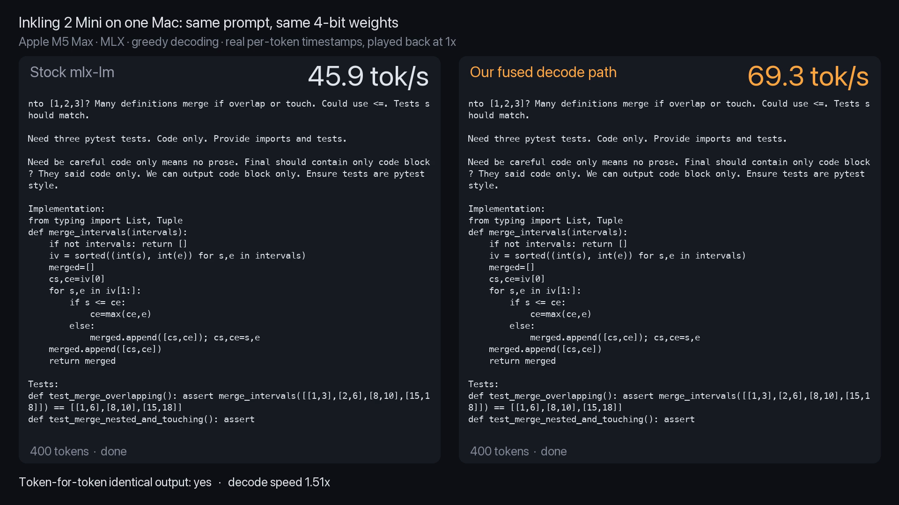

# inkling2-mlx-fastpath

**Inkling 2 Mini decodes 1.49× faster on a Mac, with token-for-token identical output.**

A drop-in decode path for [Inkling 2 Mini](https://huggingface.co/mlx-community/Inkling-2-Mini-4bit) on MLX
(mlx-lm with [ml-explore/mlx-lm#2086](https://github.com/ml-explore/mlx-lm/pull/2086)). Same 4-bit weights, same
greedy tokens, about 47 → 70 tok/s on one Apple M5 Max.

▶ [Demo video (mp4, 11 s)](demo/inkling2-mac-compare.mp4): stock vs fast path, real per-token timestamps.



## Results

Apple M5 Max (128 GB), MLX 0.32.4, `mlx-community/Inkling-2-Mini-4bit`, batch 1, greedy, 256 new tokens,
code-generation prompts. Each candidate run alternates with a stock run in the same process; the score is the
median of the paired ratios. A candidate only counts if its greedy token sequence equals stock's on every prompt.

| | Decode tok/s | Paired speedup, **held-out prompts** | Same tokens | Record |
| --- | ---: | ---: | :---: | --- |
| Stock mlx-lm | 45.0 | 1.00× | — | `rounds/r4/score-holdout.json` |
| Earlier best (compile two sub-blocks) | — | 1.064× | yes | upstream round 2 |
| Three-part layer path + mask kernel + fused projections | 66.8 | 1.419× | yes | `rounds/r3/score-holdout.json` |
| **+ one-kernel short convs (shipped default)** | **66.6** | **1.491×** | **yes** | `rounds/r4/score-holdout.json` |

- Noise: the spread of the stock runs inside the same round was 9.2% (holdout, round 4); the gain is ~5× that.
- Prompts were split before the search: two "evolve" prompts choose candidates, two held-out prompts (TypeScript
  retry wrapper, Rust CSV parser) are scored once at the end. Evolve gave 1.486× for the same candidate.
- Raw tok/s moves with machine temperature (stock ranged 43–48 tok/s across rounds), so compare the paired ratios,
  not tok/s across rows.
- The demo video replays real per-token timestamps recorded in one process (stock 46.0, fast path 69.5 tok/s,
  400 tokens, identical tokens; `demo/trace.json`).

### Why it is faster (mechanism)

One generated token runs 48 layer visits (24 layers; the 12-layer core is looped 3 times). Stock mlx-lm issues
about 7,600 non-view GPU ops per token and the step is launch-bound, not memory-bound: ~2.5 GB of weights read per
token would take ~5 ms, but the step takes 22 ms.

| Per decode step (`rounds/r4/mechanism.txt`) | Stock | Fast path |
| --- | ---: | ---: |
| Non-view ops in the graph | 7,624 | 3,664 |
| Python graph-building time | 3.9 ms | 1.8 ms |
| Step time | 22.1 ms | 15.3 ms |

What the fast path does, for batch-1 single-token decode only (prefill and batches use the stock code):

1. **Each layer visit becomes three parts.** Everything before the KV-cache write (residual read-in, loop message
   gates, norms, projections, short convs, L2 clips, relative position bias) is one `mx.compile` graph; the cache
   write and attention stay eager (their length changes every step); everything after (output gate, `o_proj`,
   convs, residual, MoE) is a second compiled graph. Conv states are explicit inputs and outputs.
2. **Attention mask in one Metal kernel** instead of ~12 small ops (arange, compare, gather, where, cast).
3. **Fused projections.** q/r/gate/sink share an input and become one quantized matmul; in sliding layers without
   loop messages all six (q/k/v/r/gate/sink) do.
4. **Message gates:** forget and message projections in one matmul.
5. **Each 4-tap short conv in one Metal kernel** (window, conv, residual, new state).

Tried and dropped: batching the q/k/v message gates into one batched matmul (within noise of the shipped default;
`rounds/r4`), a pure elementwise conv rewrite (no gain).

## Use it

```bash
pip install "mlx-lm @ git+https://github.com/ml-explore/mlx-lm@refs/pull/2086/head"
git clone https://github.com/zuiho-kai/inkling2-mlx-fastpath && cd inkling2-mlx-fastpath
python generate.py --model mlx-community/Inkling-2-Mini-4bit --prompt "Write a quicksort in Rust."
python generate.py --model mlx-community/Inkling-2-Mini-4bit --prompt "Write a quicksort in Rust." --stock
```

In your own code:

```python
from mlx_lm import load
import inkling2_fastpath
model, tok = load("mlx-community/Inkling-2-Mini-4bit")
inkling2_fastpath.enable(model)   # inkling2_fastpath.disable() restores stock
```

## Reproduce the numbers

```bash
python bench/rsi_mlx.py <model-dir> rounds/r4 --split evolve  --max-tokens 256 --reps 3
python bench/rsi_mlx.py <model-dir> rounds/r4 --split holdout --max-tokens 256 --reps 3
python bench/mechanism.py  <model-dir> rounds/r4/cands/r4a_conv_kernel.py   # build/step ms
python bench/count_ops2.py <model-dir> rounds/r4/cands/r4a_conv_kernel.py   # ops per step
python demo/record.py <model-dir> . 400 demo/trace.json && python demo/render.py demo/trace.json demo/out.mp4
```

Run nothing else on the GPU meanwhile. `rounds/r1`–`r4` hold every candidate and the JSONL/JSON each round wrote
(the code is the code that was measured; comments translated afterwards).

## How it was found

Four rounds of an [InferRSI](https://github.com/InferMatrixLab/InferRSI)-style search loop: an agent writes
candidates from the model source, a fixed harness scores them with the gates above (token identity, paired
scoring, < 5% = no conclusion, evolve/holdout split, mechanism probe), and the next round builds on what was kept.
Rounds 1–2 compiled isolated sub-blocks (best 1.064×). A per-module profile then showed the attention half of each
layer cost ~240 µs, more than the MoE, almost all in small ops; rounds 3–4 attacked that.

## Limits

- One machine, batch 1, short prompts (< 1k tokens); long contexts, other Macs and other quantizations are not
  measured.
- "Same output" means identical greedy tokens on the prompts tested (4 scoring prompts plus the demo prompt).
  The compiled graphs are not proven bit-exact for every input.
- Needs the mlx-lm Inkling 2 code from PR #2086 (`0c4c991`); it monkeypatches `DecoderLayer.__call__`.

## License

MIT
